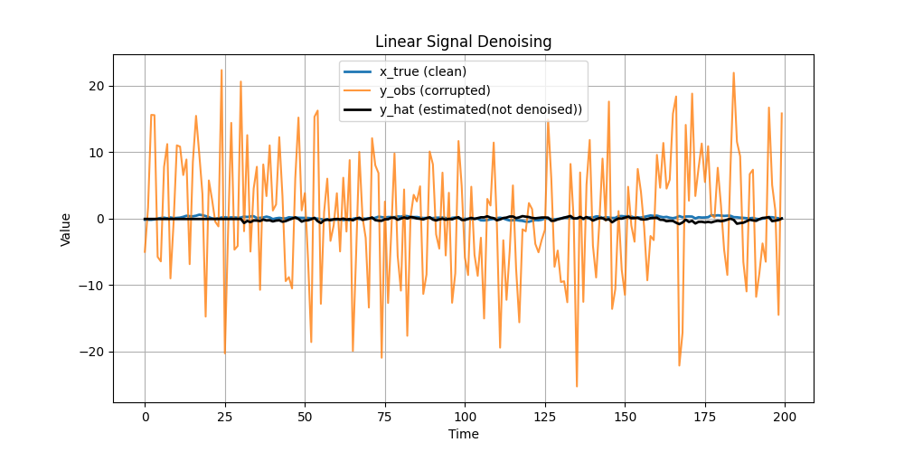
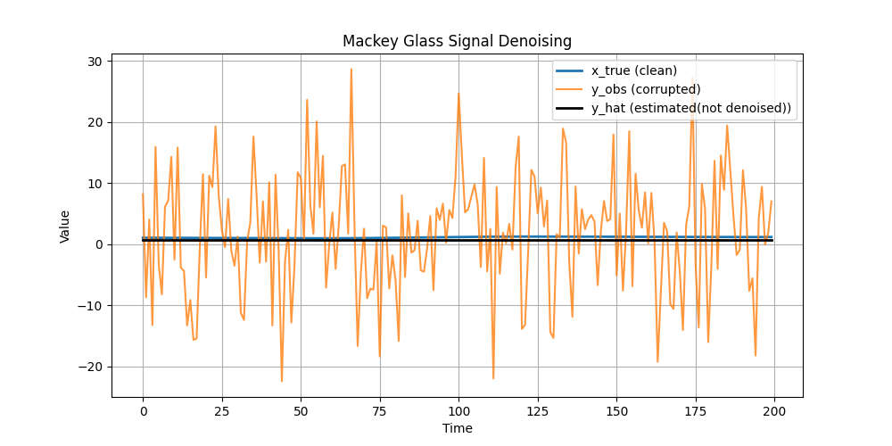
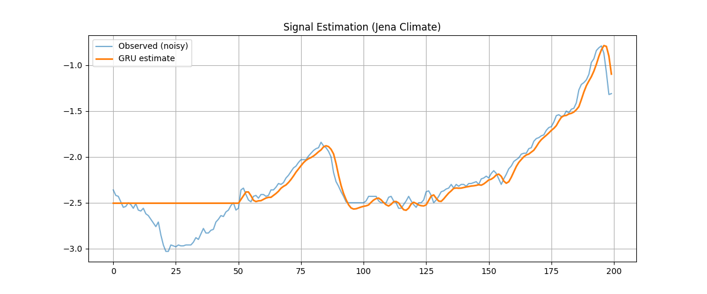

# SDN-KNet

### Self-Supervised Discovery of Noise and Delay in Time Series Without Ground Truth for State Estimation

This repository contains our course project on noise and delay estimation in time-series data. We explored different neural network and filtering approaches, starting from simple synthetic signals and gradually moving to nonlinear and real-world data. Our main goal was to understand whether we could estimate observation noise and temporal delay without having access to a clean reference signal.

As part of this work, we proposed **Self-Supervised Delay and Noise Aware KalmanNet (SDN-KNet)**. The idea was to first estimate noise and delay from corrupted observations, and then use those estimates to improve state estimation with KalmanNet.

**The results were mixed.** Our experiments showed some promising behavior for noise estimation and signal reconstruction. However, the delay estimation part did not work as expected. Because of that, we could not demonstrate the complete SDN-KNet pipeline as a reliable delay-aware state-estimation method. We are keeping the implementation, experiments, and results here to document what we tried and what we learned.

**Project documents:** [Updated final report](CSCI_547_Project_Report_updated_final.pdf) | [Presentation](csci-547-group5-presentation_v1.pdf)

## Project information

| | |
| --- | --- |
| **Course** | CSCI 547 — Advanced Machine Learning |
| **Project** | Group 5 course research project, Spring 2026 |
| **University** | Montana State University |
| **Department** | Computer Science |
| **Course instructor** | Dr. John Sheppard |
| **Authors** | Jeff Simpson and Sarker Safat Mahmud |
| **Proposed architecture** | Self-Supervised Delay and Noise Aware KalmanNet (SDN-KNet) |

## Motivation

In many real-world systems, we cannot directly observe the actual state. Instead, we receive measurements from sensors. These measurements may contain noise, delay, or both. This makes state estimation more difficult, especially when we do not have a clean signal to compare with.

We considered the observation model:

$$
y(t) = x(t-d) + \epsilon(t),
$$

where $x(t)$ is the underlying state, $y(t)$ is the observed signal, $d$ is the temporal delay, and $\epsilon(t)$ is additive observation noise.

From this, we focused on two questions:

1. Can we estimate the delay and noise variance using only the corrupted observations?
2. If we can estimate them, can we use that information to improve the state estimate?

## How the project developed

We did not start directly with SDN-KNet. We worked through several experiments to understand the problem and check how different approaches behave.

### 1. Simple linear signal

We first used a simple linear function, $y = at + b$, and added artificial Gaussian noise and delay. The purpose was to check our data preparation and corruption pipeline before moving to more complex systems.

The GRU baseline was able to follow the general trend of the noisy signal. This was a useful starting point, but it did not tell us whether the actual delay could be identified.

### 2. Linear dynamic system

Next, we worked with a linear state-space model. Since the system was synthetic, we could generate clean states and then introduce known noise and delays for evaluation.

We experimented with a **GRU baseline**, a **classical Kalman filter** (including an EM-based setup), and **KalmanNet**. The filtering approaches performed well when their assumptions matched the linear system. However, our residual-based approach still did not estimate the injected delay correctly.

### 3. Nonlinear Mackey–Glass time series

After the linear experiments, we moved to the **Mackey–Glass** chaotic time series. This allowed us to test the methods with more complex temporal behavior.

We again added noise and observation delays to the synthetic sequences. The GRU could reconstruct the general signal pattern reasonably well, but this did not mean it had discovered the delay. We also observed that KalmanNet performed worse in this nonlinear setting compared with the linear case.

The intrinsic delay in the Mackey–Glass equation is different from the additional observation delay introduced in our experiments.

### 4. Jena Climate dataset

Finally, we used the **Jena Climate** dataset as a real-world experiment, focusing on its temperature measurements. Unlike the synthetic datasets, we did not have a separate clean hidden-state signal for direct evaluation.

We tested how the models reconstructed missing or masked observations. The GRU produced relatively smooth estimates and followed the temperature trend. KalmanNet did not show a clear improvement over the GRU in this experiment.

## Proposed SDN-KNet approach

Our proposed method has two stages:

```text
Corrupted time series y(t)
          |
          v
   GRU next-step predictor
          |
          v
 Prediction residuals r(t)
          |
          +----> Cross-correlation ----> Estimated delay
          |
          +----> Differenced variance -> Estimated noise variance
          |
          v
  Intended delay/noise-aware KalmanNet stage
          |
          v
     Estimated system state
```

### Phase 1: Noise and delay estimation

We trained a gated recurrent unit (**GRU**) to predict the next observation from previous corrupted observations. We then calculated the prediction residuals:

$$
r(t) = y(t) - \hat{y}(t).
$$

We used these residuals in two ways:

- **Delay estimation:** We used cross-correlation between the residuals and observed sequence, looking for the lag with the highest correlation.
- **Noise estimation:** We estimated noise variance from the differences between consecutive residuals:

$$
\hat{\sigma}^{2} = \frac{\operatorname{Var}(r(t)-r(t-1))}{2}.
$$

This phase was designed to work without a clean reference signal during estimation. The known corruption values in the synthetic datasets were used afterward to evaluate the estimates.

### Phase 2: State estimation with KalmanNet

Our next idea was to use the estimated delay and noise variance to condition a **KalmanNet** filter. KalmanNet builds on classical Kalman filtering by learning part of the filtering process using a neural network.

However, this second stage depends on getting a meaningful delay estimate. Since our delay estimates were not reliable, we could not validate the expected improvement of the complete SDN-KNet approach. Also, the KalmanNet training described in the report uses state trajectories for the synthetic experiments, so the whole pipeline should not be understood as fully ground-truth-free in every stage.

## Experiments and observations

For the synthetic systems, we explored noise-only, delay-only, and combined noise-and-delay settings. The updated report describes injected observation delays of $d \in \{0, 2, 5, 10\}$, along with different noise conditions. We also tested different model configurations and compared reconstruction and prediction errors.

The following results are taken from the summary table in our [updated report](CSCI_547_Project_Report_updated_final.pdf). They are included to give an overview of our experiments, not as a single benchmark where all datasets were evaluated in exactly the same way.

| Dataset | Model | Reported RMSE |
| --- | --- | ---: |
| Linear system | GRU | 0.41 |
| Linear system | Kalman Filter with EM | 0.25–0.35 |
| Linear system | KalmanNet | 0.26 |
| Mackey–Glass | GRU | 0.39 |
| Mackey–Glass | KalmanNet | 1.08 |
| Jena Climate | GRU | ~0.27 |
| Jena Climate | KalmanNet | ~0.27 |

### What we found

**Noise estimation:** The residual-based noise estimator gave encouraging results in several settings. However, the error also increased under some noise conditions, so it was not consistently accurate.

**Delay estimation:** This was the main problem in our approach. In the detailed linear state-space experiment, the estimated delay stayed at **1** when the actual injected delays were **0, 2, 5, and 10**. In our broader discussion, we described the estimates as staying close to zero instead of following the true delay. Both observations point to the same limitation: we were not able to recover the actual delay.

**GRU behavior:** GRU models could still learn useful temporal patterns from corrupted sequences. In some experiments, they handled delayed observations well without explicitly identifying the delay.

**KalmanNet behavior:** KalmanNet worked better for the linear system than for the nonlinear and real-world datasets we tested. We did not observe the expected advantage from our proposed delay-aware extension.

Overall, we found that predicting or reconstructing a noisy time series is not the same as estimating the noise and delay that produced it. This was one of the important outcomes of our project.

## Some experiment figures

The figures below are examples from the repository. More plots and explanations are available in the report.

**Linear signal — GRU baseline**



**Mackey–Glass — GRU experiment**



**Jena Climate — GRU experiment**



## Repository contents

The code was developed over several iterations. The main directories currently include:

| Directory | Contents |
| --- | --- |
| `data/` | Dataset preparation and related code |
| `models/` | Model implementations |
| `training/` | Training-related code |
| `experiments/` | Experimental scripts |
| `configs/` | Experiment configurations |
| `analysis/` | Analysis and supporting experiments |
| `utils/` | Shared utilities |
| `slurm/` | Scripts for running jobs on a cluster |
| `v2/` | Later experimental work |

The current repository also has experiment images and project PDFs in the root directory. These may be moved into separate `results/` and `docs/` folders during repository cleanup.

## Setup

Clone the repository and create a Python environment:

```bash
git clone https://github.com/Safat99/SDN-KNet.git
cd SDN-KNet
python -m venv .venv
source .venv/bin/activate
```

On Windows PowerShell, the activation command is `.venv\Scripts\Activate.ps1`.

The code uses libraries such as NumPy, TensorFlow, Matplotlib, SciPy, PyYAML, pykalman, and Optuna. **The current `requirements.txt` still needs a small cleanup** (it contains a `.codex` entry that should be checked before using `pip install -r requirements.txt`).

Since the experiments were developed at different stages, there is not yet one verified command that reproduces every result. Please refer to the corresponding experiment scripts and configurations. The final report is the main reference for the experimental settings and findings.

## Limitations and future work

Our main limitation is that the delay estimator did not correctly identify the inserted delays. This also affected our ability to evaluate the full two-stage SDN-KNet approach.

Some useful directions for future work are:

- Studying whether a fixed observation delay can be identified from a single corrupted sequence without an external timing reference.
- Testing other methods for delay estimation and better ways to separate prediction error from observation noise.
- Considering nonlinear dynamics, time-varying or fractional delays, and multivariate sensor data.
- Running more detailed ablation studies and comparing against additional baselines.
- Making the experiment configuration, dependencies, and result generation more reproducible.

## Report and presentation

- **Final report:** [Self-Supervised Discovery of Noise and Delay in Time Series Without Ground Truth for State Estimation](CSCI_547_Project_Report_updated_final.pdf)
- **Presentation:** [CSCI 547 Group 5 presentation](csci-547-group5-presentation_v1.pdf)

The full report includes our method, experimental setup, figures, results, discussion, and references to related work on Kalman filtering, GRUs, KalmanNet, and noise/delay estimation.

## Authors and acknowledgment

**Jeff Simpson** and **Sarker Safat Mahmud**  
Department of Computer Science, Montana State University  
CSCI 547 — Advanced Machine Learning, Spring 2026

We thank **Dr. John Sheppard**, our course instructor, for the opportunity to work on this project. The report also acknowledges the use of Claude and ChatGPT for background research and grammar checking.

---

*This repository documents an academic course research project. SDN-KNet is a proposed approach that we investigated, not a validated solution for general delay estimation.*
